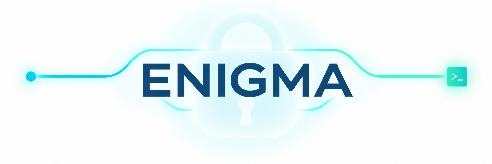

<p align="center">
  
</p>

# Enigma

<div align="center">

[](LICENSE) [](https://deepwiki.com/Clarit-AI/enigma) 

</div>

**Stop pasting secrets into the chat: Enigma keeps them secure while your agent keeps working.**

[Quick start](#quick-start) | [Proof](#proof) | [Docs](#details) | [Security](docs/SECURITY.md)

Status: pre-release, targeting v1 ([latest release](https://github.com/Clarit-AI/enigma/releases)). Enigma runs as a Claude Code plugin today.

## The problem

You ask your agent to call the OpenAI API from your project. It needs a key, so it asks you to paste it into the chat, or it reads it from a `.env` file or `security find-generic-password` itself. Either way the key is now in the transcript, in every later prompt, and in whatever logging or caching sits behind the model.

1Password, the OS keychain and `direnv` store secrets well, but none of them cover the handoff into an agent session: the values they hold still end up typed into chat or `cat`'d onto a screen the agent reads.

## The solution

Enigma is a security tool for coding agents. It keeps secret values out of their context window and works with the secret stores you already use.

**Your agent uses secrets it never sees.** Enigma's MCP tools carry names only. `enigma run` injects the value into the command that needs it, and `enigma_reveal` shows it to you, never to the agent.

**It stores secrets where you already keep them.** Pick the macOS Keychain, Linux secret-service, 1Password, Enigma's own encrypted file, or a managed block in your project's `.env`. There's no new vault to set up.

**You hand over a secret however you're working.** Enter it in a native system dialog (macOS) or in a one-time web form. The form can run through a Cloudflare or Tailscale tunnel, so you can answer a request from your phone while you keep an eye on a session from somewhere else. Each link is single-use and expires.

## Proof

- **The MCP tool surface has no `get`.** Every one of the 7 tools returns names, depository ids, scopes, and status only, checked by `test/security/no-value-leak.test.ts` and `test/security/leak-fence.test.ts` ([`docs/api-contracts.md`](docs/api-contracts.md) §1). You enter values through MCP URL-mode elicitation, which the 2025-11-25 MCP spec mandates for credentials, so the agent's tool call gets back only `"Stored OPENAI_API_KEY in encrypted (project)"`. A static check, `npm run leak-fence`, fails the build if any code under `src/mcp/**` or `src/web/**` calls the internal `resolve()` that reads a plaintext value, so the rule is enforced at build time and not just by convention.
- **Two enforcement layers.** A `PreToolUse` read-guard denies calls that would pull a value into the session by accident (`.env` reads, `op read`, `echo $TRACKED_NAME`, and more). A `PostToolUse` tripwire warns if a tracked value shows up in tool output. Neither is a sandbox against deliberate evasion ([`docs/hooks.md`](docs/hooks.md)).
- **Values never touch argv, a URL, or a temp file.** Every OS integration (`security -i`, `secret-tool store`, `op item create`, `osascript`) receives the value on stdin ([`docs/style-guide.md`](docs/style-guide.md)).

Enigma is not a password manager or a 1Password replacement: it doesn't sync, share, or organize secrets, it gets them from where they live to the agent's commands safely. It guards against an agent reading a secret by accident and against values leaking through tool output. It isn't a defense against malware running as your user or an agent deliberately trying to get around it ([`docs/SECURITY.md`](docs/SECURITY.md) has the exact boundary). Known limits while it's pre-release: clipboard reveal is macOS only, the tunnel link is a bearer link with no PIN in v1, and the npm package `@clarit.ai/enigma` is shelved and was never published, so the plugin marketplace is the only install path.

## Quick start

1. Install the plugin from the marketplace:

   ```bash
   claude plugin marketplace add Clarit-AI/enigma
   claude plugin install enigma@clarit-enigma
   ```

2. Start a Claude Code session in your project. On the first session Enigma puts `enigma` on your `PATH` with one symlink and tells you it did.

3. Ask for a key from inside the session:

   ```text
   > I need to add my OpenAI API key so I can call the API from this project.
   ```

   Claude Code calls `enigma_request`, which opens a local form at `http://127.0.0.1:<port>/r/<id>` (or, on macOS only, a native dialog). You type the key there, once, out of band.

4. Use it:

   ```bash
   enigma run -- node scripts/call-openai.mjs   # injects OPENAI_API_KEY into the child only
   enigma list                                  # names, scopes, depositories, never values
   ```

The agent only ever saw `Stored OPENAI_API_KEY in encrypted (project)`. If `enigma` isn't found on your `PATH`, run `/enigma:doctor` in the session to see why. Developing on Enigma itself? See [`docs/install.md`](docs/install.md).

## Details

- [`docs/install.md`](docs/install.md): marketplace and checkout installs, why npm is shelved, and how `enigma` gets on your `PATH`.
- [`docs/usage.md`](docs/usage.md): the first request step by step, answering from your phone, the six slash commands, and the full CLI reference.
- [`docs/depositories.md`](docs/depositories.md): the five depositories and their prompt profiles, and declaring a project's secrets in `.enigma.json`.
- [`docs/render.md`](docs/render.md): rendering secrets into a worktree's `.env` for apps that read one.
- [`docs/hooks.md`](docs/hooks.md): what the `SessionStart`, `PreToolUse` and `PostToolUse` hooks do.
- [`docs/faq.md`](docs/faq.md): CI and cron use, revealing a value yourself, remote access, and why not just use 1Password directly.
- [`docs/SECURITY.md`](docs/SECURITY.md): the threat model, what Enigma protects against and what it doesn't, and how to report a vulnerability.
- [`docs/api-contracts.md`](docs/api-contracts.md) and [`docs/architecture.md`](docs/architecture.md): tool schemas, routes, file formats and the design decisions behind them.
- [`PRD.md`](PRD.md) and [`PROJECT_CONTEXT.md`](PROJECT_CONTEXT.md): the product requirements and the engineering index.

## Ecosystem context

Enigma is part of the Clarit.AI open-source ecosystem. Enigma focuses on keeping secret values out of an agent's context during a coding session, while Engram focuses on persistent memory for AI conversations and Synapse focuses on hybrid NPU/CPU inference routing on edge hardware.

## Contributing

Issues and PRs are welcome. Read [`PROJECT_CONTEXT.md`](PROJECT_CONTEXT.md) first. It indexes the architecture decisions (`docs/architecture.md`), API contracts (`docs/api-contracts.md`), and style guide (`docs/style-guide.md`) that every change is expected to follow. Every PR adds or updates tests for its Issue's acceptance criteria and keeps `docs/api-contracts.md` in sync with any interface it touches.

## License and acknowledgements

Apache-2.0. See [LICENSE](LICENSE). Enigma's request/reveal store, network-policy, Linux secret-service pattern, and static leak-fence design are harvested from ClawVault, not forked (see ADR-007 in [`docs/architecture.md`](docs/architecture.md) for exactly what was kept and what wasn't).
